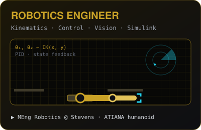

  <b>CTO</b> &nbsp;|&nbsp; <b>Technical Lead</b> &nbsp;|&nbsp; <b>Senior Software Engineer</b> &nbsp;|&nbsp; <b>Full-Stack, AI &amp; Robotics Engineer</b> &nbsp;|&nbsp; <b>Game Developer</b> 
  Tech Talk ’24 Speaker &nbsp;·&nbsp; MCA &nbsp;·&nbsp; MEng Robotics @ Stevens ’28

  
  
  
  
  

  

I'm a **product-minded engineer and technical leader** with **6+ years** of shipping full-stack, AI and game software across web, mobile and 3D, and now humanoid robotics.

I founded **SJA Inc.**, a bootstrapped company with **$0 in outside funding** that runs three product lines: **AI careers and EdTech**, a **browser-based 3D game studio** and a **humanoid robotics lab**. I'm its CEO and CTO, and I write a lot of the code myself. Before that I led product and engineering at **Map.ca**, shipped life-sciences software at **GenRAIT**, and gave **600+ code reviews** at **Microverse**.

I'm doing a **Master of Engineering in Robotics at Stevens Institute of Technology**, on top of an MCA. That's why my side projects include robot arm kinematics, PID and state-feedback control, and computer vision.

> **I like owning the whole stack, from the database's row-level security to the robot's inverse kinematics.**

 

##  Three crafts, one engineer

  
  
  

| 🎮 **Game development** | 💻 **Software engineering** | 🤖 **Robotics & AI** |
|---|---|---|
| **Ouria**: a browser 3D multiplayer MMO with 12 realms, avatars, real-time sync and mini-games, built with Three.js, React Three Fiber and Durable Objects | **JPlatform** and **EPlatform**: AI career and learning SaaS that I built solo, used in 15+ countries | **ATIANA**: a modular humanoid ecosystem covering hands, arms, vision, motion planning, safety and a digital twin |
| **Apex Games**: as co-founder and CTO, led a carnival-themed Unity/C# MMO and secured grant funding | Built an AI WordPress automation platform with **9,378 automated tests** and a 49/50 clean-build streak | **Fari**: ATIANA's reasoning, communication and task-planning intelligence |
| **Escape™ App AI**: LLM-driven avatars, facial mood tracking and AI soundscapes in Unreal Engine | Security audit across **4 Supabase projects**, CI/CD and credential rotation at Map.ca | **MOUS**: an Arabic-dialect-aware AI voice and WhatsApp agent with mood detection |

##  The CTO console: SJA Inc.

  

A multi-product technology company spanning **AI, SaaS, EdTech, 3D gaming and humanoid robotics**, bootstrapped with **$0 in outside funding**. It serves **40+ subscribers across 15+ countries**, and **8 members have landed jobs** through it. As CTO I own the architecture, security, CI/CD and engineering quality across every product line.

| Company | My role | What's live |
|---|---|---|
| 🧭 **[SJA Pathway](https://sjapathway.com)** | Lead Full-Stack & AI Engineer | [JPlatform](https://jplatform.sjapathway.com/): AI CV/ATS scoring, Smart Apply, mock interviews · [EPlatform](https://eplatform.sjapathway.com): 86 courses, AI mentor with memory, coding playground · [AIPath](https://aipath.sjapathway.com): open-source career AI |
| 🌌 **[SJA Verse](https://verse.sjapathway.com)** | Lead Game Developer & 3D Engineer | [Ouria](https://verse.sjapathway.com/ouria): "One Universe. Realms & Infinite Adventures.", a free 3D world in the browser |
| 🦾 **[SJA Robotics](https://robotics.sjapathway.com)** | Lead Robotics & AI Engineer | [ATIANA Virtual Lab](https://robotics.sjapathway.com/atiana-virtual-lab/) · [Hand Simulator](https://atiana-hand.pages.dev) · [Fari](https://robotics.sjapathway.com/fari/) · [MOUS](https://robotics.sjapathway.com/mous/) · [Sueen](https://robotics.sjapathway.com/sueen/) |

##  Tech arsenal

<table align="center">
  <tr>
    <td align="center" width="25%"><b>🎮 Game & 3D</b>  </td>
    <td align="center" width="25%"><b>💻 Full-stack</b>  </td>
    <td align="center" width="25%"><b>☁️ Cloud & data</b>  </td>
    <td align="center" width="25%"><b>🤖 AI & robotics</b>  </td>
  </tr>
</table>

  
  
  
  
  
  
  
  
  
  

##  Career log

| When | Role | Where | Highlights |
|---|---|---|---|
| **Mar 2025 →** | 👑 **Founder, CEO & CTO** | SJA Inc. | 3 product lines, built solo or leading a team, live in 15+ countries |
| **May 2026 →** | ⚙️ Full-Stack Developer & Automation Engineer | Upwork · Freelancer.com | AI site-generation platform (9,378 tests), SaaS hosting portal with 20+ integrations, Upwork *Rising Talent* |
| Nov 2025 – Mar 2026 | 🗺️ **Product & Engineering Lead** | Map.ca | Led a team of 8 across 3 platforms, Supabase security audit, CI/CD, Google.org AI grant application |
| May – Dec 2025 | 🎭 AI & Game QA Developer | Escape™ App AI | LLM avatars, facial mood tracking with PyTorch and TensorFlow, Unreal iOS builds |
| Feb – Apr 2025 | 🔭 Software Developer | iTelescope.net | Legacy C#/VB/ASP refactor into .NET Core and Blazor, Docker |
| May 2024 – Nov 2025 | 🌍 Full-Stack PHP Developer | Clients in the US, Europe and Asia | Laravel, Next.js, WHMCS automation, GCP App Engine, CI/CD |
| Sep 2022 – Jun 2025 | 🎡 **Co-Founder & CTO** | Apex Games | Unity/C# carnival MMO, grant funding, tech talk to 150+ attendees |
| Jan 2023 – Feb 2024 | 🧬 **Senior Software Engineer** | GenRAIT Inc. | MEAN stack with FastAPI microservices on AWS, E2E testing with TestCafe and Cypress, ML for life sciences |
| Mar 2022 – Feb 2023 | 🧑‍🏫 Technical Support Engineer | Microverse | 600+ code reviews across React, Redux, Rails and PostgreSQL |

<b>🎓 Education & certifications</b>

 

| | |
|---|---|
| 🤖 **MEng, Robotics**, Stevens Institute of Technology (2024 → ’28) | Modern control, autonomous navigation, ML, CAD, biomechanics · robot arm kinematics, PID and state-feedback simulation, concentric tube robots |
| 💻 **Master of Computer Applications**, Suresh Gyan Vihar University (2021) | GPA 3.84/4 · capstone *"Atiana The Robo World"*, a Unity/C# game, which is where ATIANA began |
| 🖥️ **Bachelor of Computer Applications**, Alagappa University (2017) | Microprocessors, C/C++, Java, Oracle, RDBMS |
| 🏅 **Certifications** | IBM AI Developer · MathWorks Computer Vision Engineer · Aerial Robotics and Computational Motion Planning (UPenn) · MATLAB, Simulink, Simscape and Stateflow · Matrix Algebra and Differential Equations (HKUST) · Firebase ×3 · UiPath RPA · Full-Stack Development (Microverse) |
| 🏆 **Honours** | Gulf Mathematics Olympiad (2012) |

##  Telemetry

  

  
  

  
  
  

<picture>
  <source media="(prefers-color-scheme: dark)" srcset="https://raw.githubusercontent.com/sja-thedude/sja-thedude/output/snake-dark.svg"/>
  <source media="(prefers-color-scheme: light)" srcset="https://raw.githubusercontent.com/sja-thedude/sja-thedude/output/snake-light.svg"/>
  
</picture>

##  Beyond the code

- ✍️ **Writer**: motivational and lifestyle articles for *Life Lovers Magazine* and on Medium, plus a LinkedIn audience of 7k+
- 🤝 **Community**: I run a WhatsApp community that shares job openings and mentor developers who are early in their careers
- 🧠 **INTJ**: analytical and strategic, and I think before I act
- ♟️ ⛹️‍♀️ **Chess and basketball**, workouts, music, and travelling to new cultures
- 🦁 People say I'm like a lion: relentless and fearless, and I go after what I want
- 🗣️ English · Hindi · Arabic

  
  
  
  
  
  

⚡ Graphics are hand-built animated SVGs, and the activity graph and snake regenerate twice a day by GitHub Action.

